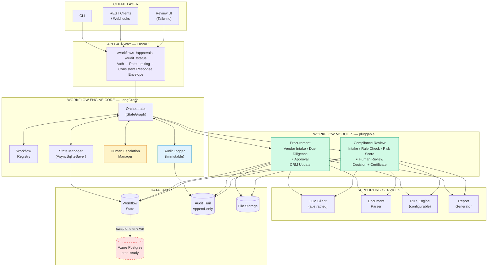
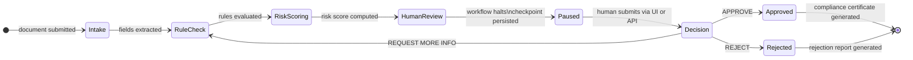
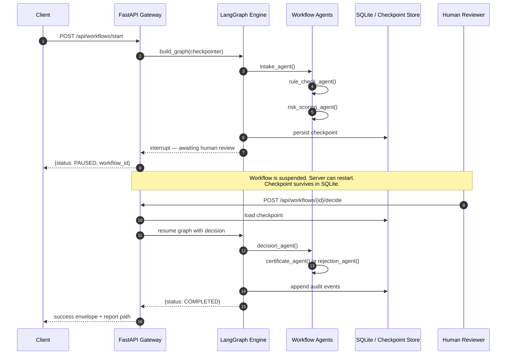
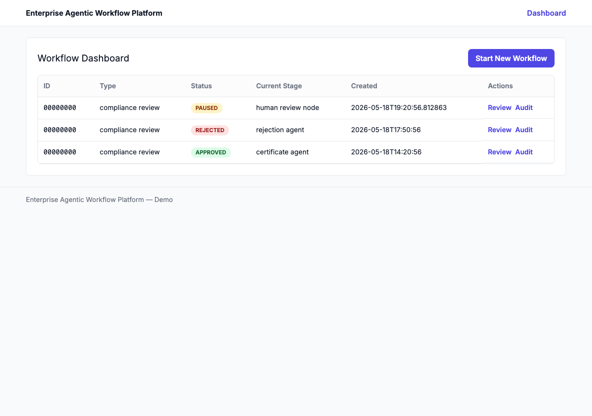
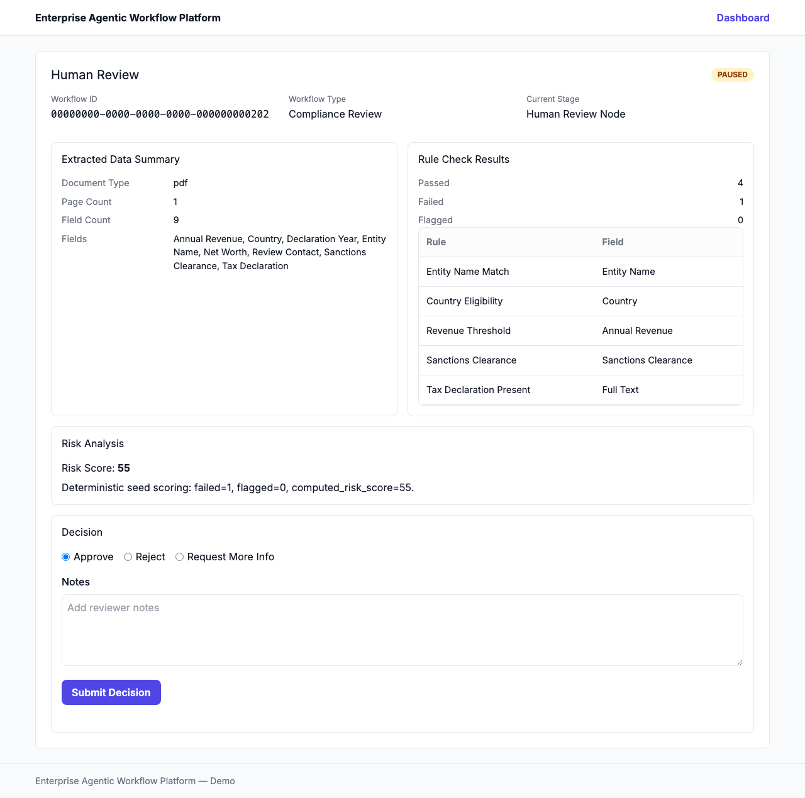
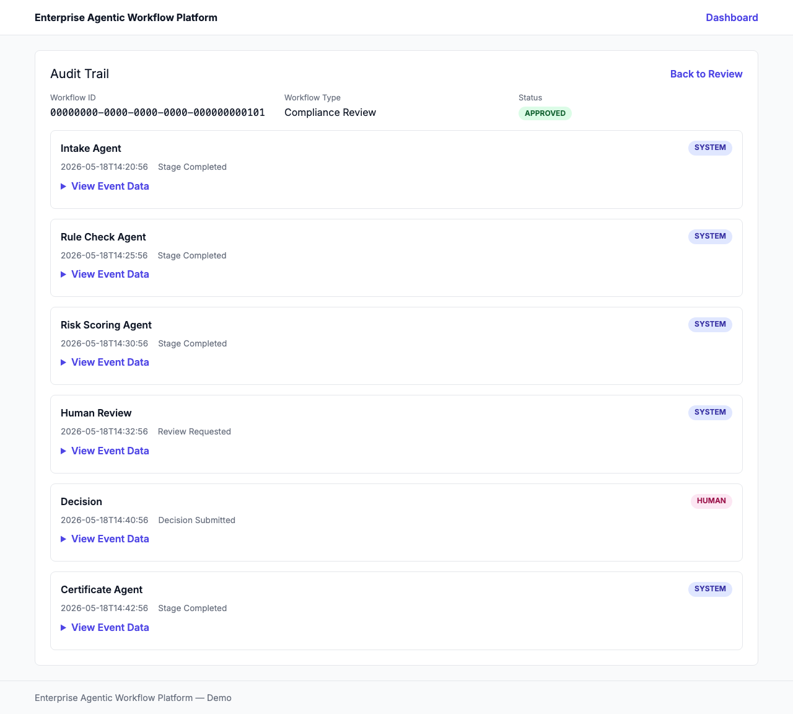

# Multi-Agent Orchestration Platform

> Pluggable enterprise workflow automation with persistent human-in-the-loop approval, immutable audit trails, and LLM-powered decision support.


---

## The Problem

Enterprise workflows that cross systems — compliance reviews, vendor approvals, procurement sign-offs — typically rely on email chains, spreadsheet trackers, and manual handoffs. There is no persistent state, no guaranteed audit trail, and no operational visibility into where a workflow is, who touched it, or why a decision was made.

When something goes wrong, the answer is in someone's inbox. When regulators ask questions, the answer is in a spreadsheet that three people have edited.

This platform replaces that pattern with an orchestrated system where every workflow is versioned, every decision is logged, and every agent action is traceable.

---

## What It Does

- **Orchestrates multi-step workflows across AI agents and human reviewers** — workflows pause at decision points, persist state across server restarts, and resume exactly where they stopped
- **Enforces human-in-the-loop approval as a first-class architectural primitive** — not a workaround or a polling loop, but a genuine checkpoint in the state machine
- **Produces a tamper-evident audit trail for every workflow run** — every agent action, rule evaluation, risk score, and human decision is logged with timestamp, actor, and structured payload

---

## System Architecture



---

## Compliance Review — State Machine

The compliance review workflow is the primary demonstration of the platform's human-in-the-loop capability. The workflow genuinely pauses at the review step — state is persisted to SQLite and the graph resumes only when a human submits a decision via the API.



---

## Human-in-the-Loop — Sequence



---

## Key Capabilities

| Capability | Detail |
|------------|--------|
| **Persistent workflow state** | LangGraph `AsyncSqliteSaver` checkpoints survive server restarts — no workflow is lost on restart or crash |
| **Real human-in-the-loop** | Workflows pause at configured interrupt points and resume only on human decision — not a polling loop or a simulation |
| **Immutable audit trail** | Every agent action, rule result, risk score, and human decision is appended to an ordered event log — never updated, never deleted |
| **Pluggable workflow modules** | Adding a new workflow requires one new module in `workflows/` — the registry discovers and loads it automatically |
| **LLM provider abstraction** | Switch between Anthropic and OpenAI by changing a single environment variable — no code changes |
| **Regulated-industry ready** | Audit trail, sanitized logging (no document content in logs), configurable rule engine, and Azure deployment path built in |

---

## Included Workflows

### Compliance Review
Designed for regulated industries — financial services, healthcare, legal — where vendor or document compliance must be evaluated against a defined rule set, reviewed by a qualified human, and recorded with full traceability.

**Stages:** Document intake → Configurable rule evaluation → LLM-powered risk scoring → Human review (paused) → Approve / Reject / Request more information → Compliance certificate or rejection report

### Procurement
Vendor onboarding and approval with automated due diligence, human sign-off, and CRM record creation on approval.

**Stages:** Vendor intake → Automated due diligence → Human approval (paused) → CRM update

---

## Quickstart

```bash
# 1. Clone and set up environment
git clone https://github.com/manjunath-hanmantgad/multi-agent-orchestration.git
cd multi-agent-orchestration
python3 -m venv .venv && source .venv/bin/activate
pip install -r requirements.txt

# 2. Configure
cp .env.example .env
# Add your ANTHROPIC_API_KEY (or OPENAI_API_KEY) to .env

# 3. Initialise the database
python scripts/init_db.py

# 4. Seed demo data (creates three pre-run workflows: APPROVED, PAUSED, REJECTED)
python scripts/seed_demo.py

# 5. Start the platform
uvicorn api.main:app --host 127.0.0.1 --port 8000 --reload &
uvicorn app.main:app --host 127.0.0.1 --port 8001 --reload
```

| Endpoint | URL |
|----------|-----|
| Dashboard | http://127.0.0.1:8001/dashboard |
| Human review screen | http://127.0.0.1:8001/review/00000000-0000-0000-0000-000000000202 |
| Audit trail | http://127.0.0.1:8001/audit/00000000-0000-0000-0000-000000000202 |
| API health | http://127.0.0.1:8000/api/health |

---

## Screenshots

**Dashboard** — three workflow states, live from the database



**Human review screen** — extracted fields, rule results, risk score, decision form



**Audit trail** — ordered event timeline, SYSTEM and HUMAN actor labels



---

## Demo Walkthrough

**Five minutes, three screens:**

1. **Dashboard** — open `/dashboard`. Show three workflows in different states: `APPROVED`, `PAUSED`, `REJECTED`. Status badges reflect live database state.

2. **Human review screen** — open the `PAUSED` workflow. The page shows extracted document fields, rule evaluation results (pass/fail/flag per rule), the LLM-generated risk score and reasoning, and a decision form. Submit `APPROVED`.

3. **Audit trail** — open `/audit/{id}` for the same workflow. The page shows the complete ordered event timeline: every agent action, every rule result, the human decision, and the final certificate generation — all with timestamps and actor labels.

---

## Configuration

| Variable | Required | Default | Description |
|----------|----------|---------|-------------|
| `LLM_PROVIDER` | No | `anthropic` | `anthropic` or `openai` |
| `LLM_MODEL` | No | `claude-sonnet-4-6` | Model name for the chosen provider |
| `ANTHROPIC_API_KEY` | If using Anthropic | — | Anthropic API key |
| `OPENAI_API_KEY` | If using OpenAI | — | OpenAI API key |
| `DATABASE_URL` | No | `sqlite+aiosqlite:///./workflow_platform.db` | Workflow state database |
| `CHECKPOINT_DB_URL` | No | `./checkpoints.db` | LangGraph checkpoint store |
| `SLACK_WEBHOOK_URL` | No | — | Slack notification webhook (optional) |
| `SECRET_KEY` | No | `change-me-in-production` | App secret key |

---

## Azure Production Path

The platform is designed for a zero-code-change path to Azure. Every infrastructure dependency is config-driven.

| Local | Azure Production |
|-------|-----------------|
| SQLite (`sqlite+aiosqlite:///...`) | Azure Database for PostgreSQL Flexible Server |
| `./checkpoints.db` | Azure Database for PostgreSQL (same connection) |
| Anthropic/OpenAI key in `.env` | Azure Key Vault + Managed Identity |
| `outputs/` local directory | Azure Blob Storage |
| `uvicorn` local process | Azure Container Apps |
| Slack webhook | Azure Service Bus + Logic Apps |

Full deployment steps: [docs/deployment.md](docs/deployment.md)

---

## Running Tests

```bash
pytest tests/ -v
# 56 passed, 0 failed
```

All LLM calls are mocked in tests. No API keys required to run the test suite.

---

## Tech Stack

| Layer | Technology |
|-------|------------|
| Workflow orchestration | [LangGraph](https://github.com/langchain-ai/langgraph) — StateGraph, interrupt/resume, AsyncSqliteSaver |
| API gateway | [FastAPI](https://fastapi.tiangolo.com/) + Uvicorn |
| Checkpoint persistence | LangGraph AsyncSqliteSaver (SQLite → Postgres-ready) |
| Data persistence | SQLAlchemy async + aiosqlite |
| LLM abstraction | LangChain Anthropic / LangChain OpenAI |
| Document parsing | pdfplumber, python-docx |
| UI | Jinja2 + Tailwind CSS (CDN, no build step) |
| Testing | pytest, pytest-asyncio, httpx |

---

## Architecture Reference

Full component descriptions, data layer schema, and Azure production path:
[docs/architecture.md](docs/architecture.md)
