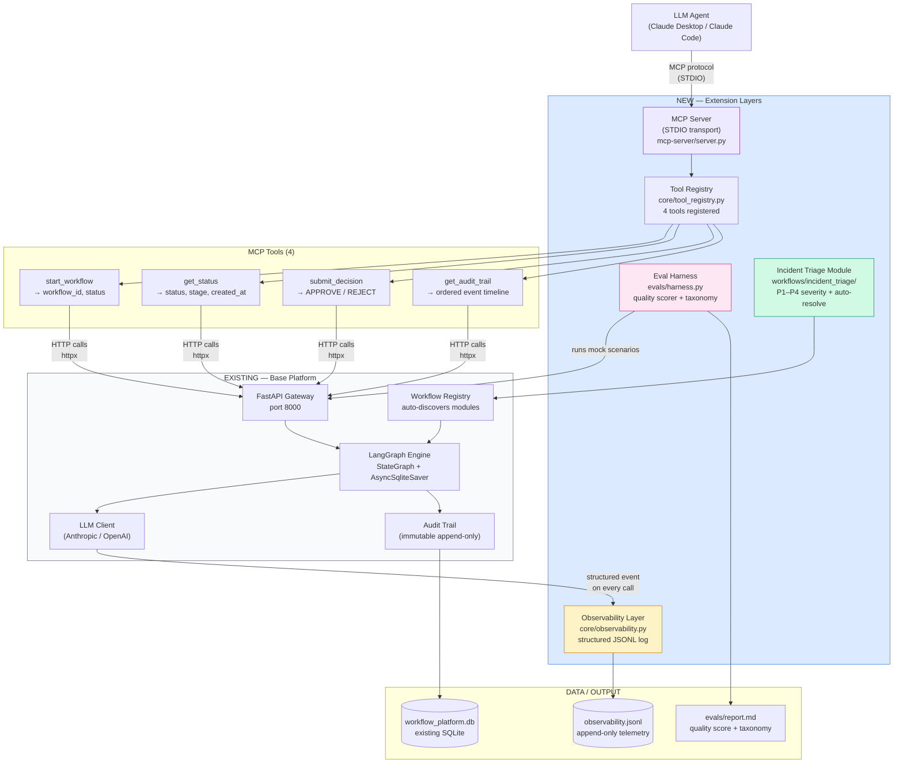
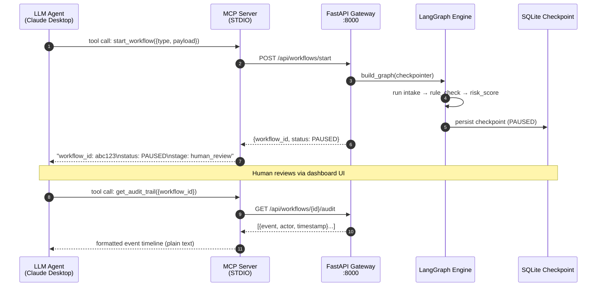
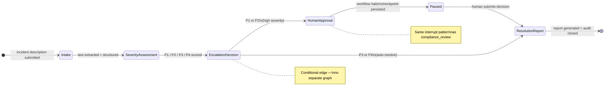
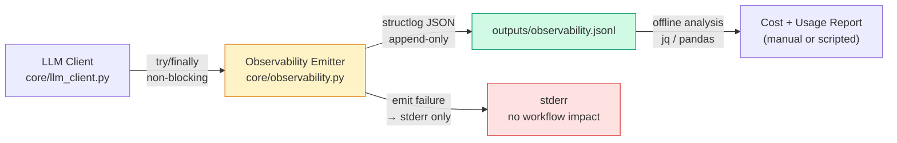

# Architecture Extension — Multi-Agent Orchestration Platform

> This document covers ONLY the new layers added in the extension build. For the base platform architecture, see `docs/architecture.md`.

---

## What Is Being Added

```
┌─────────────────────────────────────────────────────────────┐
│           FRONTEND (NEW — TASK-08/09/10)                     │
│   Next.js 14 + shadcn/ui + Tailwind CSS                     │
│   Dashboard · Review · Audit Trail · Incident Triage        │
│   localhost:3000  →  calls FastAPI at localhost:8000         │
└─────────────────────────────────────────────────────────────┘
                           │ CORS
                           ▼
┌─────────────────────────────────────────────────────────────┐
│                    EXTENSION LAYERS (NEW)                    │
│                                                             │
│   MCP Server  ──►  Tool Registry  ──►  FastAPI Gateway      │
│   Observability Hooks  ──►  LLM Client  ──►  Telemetry Log  │
│   Eval Harness  ──►  Test Dataset  ──►  Quality Report       │
│   Incident Triage Workflow  ──►  WorkflowRegistry           │
└─────────────────────────────────────────────────────────────┘
                           │
                           ▼
┌─────────────────────────────────────────────────────────────┐
│                  BASE PLATFORM (UNCHANGED)                   │
│   LangGraph Engine · FastAPI Gateway · Audit Trail          │
│   Compliance Review · Procurement · Human Approval          │
│   Jinja2 app/ server — removed in TASK-10                   │
└─────────────────────────────────────────────────────────────┘
```

---

## System Architecture Delta



---

## MCP Server — Tool Flow



---

## Incident Triage — State Machine



---

## Observability — Data Flow



**JSONL event schema (one line per LLM call):**
```json
{
  "event": "llm_call",
  "timestamp": "2026-05-30T14:22:01Z",
  "workflow_id": "abc123",
  "stage": "risk_scoring",
  "model": "claude-sonnet-4-6",
  "input_tokens": 840,
  "output_tokens": 312,
  "latency_ms": 1420,
  "estimated_cost_usd": 0.00717
}
```

---

## Key Design Decisions

| Decision | Choice | Rationale |
|----------|--------|-----------|
| MCP server calls FastAPI over HTTP | API client, not embedded module | Keeps MCP server independently deployable and testable; avoids coupling to LangGraph internals |
| STDIO transport (not Streamable HTTP) | STDIO for local dev | Zero config for Claude Desktop integration; Streamable HTTP is the Azure production step — deferred to keep scope tight |
| Observability is write-only from workflow perspective | Append-only JSONL | Adding read-back during workflow execution would couple telemetry to the hot path; offline analysis is sufficient |
| P3/P4 bypass implemented as conditional edge | Single graph, conditional routing | Adding a second graph or a separate function would break the WorkflowRegistry pattern; conditional edges are the LangGraph-native solution |
| Tool registry is a dict, not a database | In-memory catalog | Tools are registered at server startup and don't change at runtime; a database would add operational complexity for no benefit |
| Frontend: Next.js + shadcn/ui replacing Jinja2 | Next.js 14 App Router + shadcn/ui | Jinja2 + CDN Tailwind reads as a demo project to any enterprise evaluator; shadcn/ui components (built on Radix UI, used by Vercel/Linear/Loom) signal production-grade engineering; the 115k-star adoption means clients recognise the quality instantly |
| Frontend migration deferred to TASK-08/09/10 | Backend-first, frontend-last | MCP server and workflow module must be complete before UI is built; mixing frontend and backend tasks in the same sprint increases review complexity and risk of regression |
