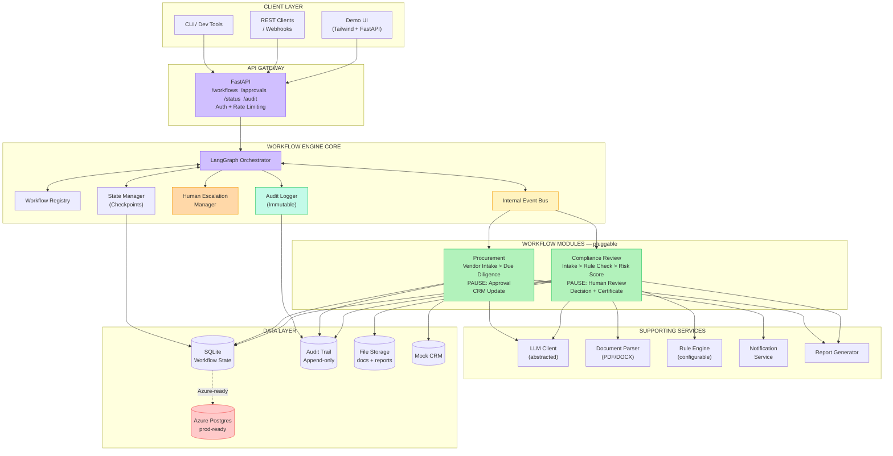
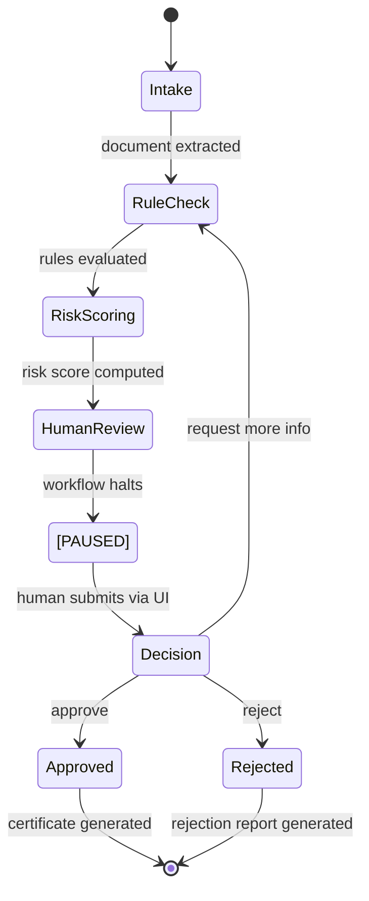

# Enterprise Agentic Workflow Platform — Architecture

## System Architecture



---

## Layer Descriptions

### Client Layer
| Component | Purpose |
|-----------|---------|
| Demo UI (Tailwind) | Browser-based dashboard: active workflows, human approval screen, audit trail, reports |
| REST Clients / Webhooks | External systems triggering workflows programmatically |
| CLI / Dev Tools | Developer trigger for testing and local runs |

### API Gateway (FastAPI)
Single entry point for all interactions. Routes:
- `POST /api/workflows/{type}/start` — trigger a new workflow run
- `GET  /api/workflows/{id}/status` — poll workflow state
- `POST /api/workflows/{id}/approve` — human submits approval decision
- `GET  /api/workflows/{id}/audit` — retrieve full audit trail
- `GET  /api/workflows` — list all active/completed workflows
- `GET  /api/health` — provider health check

### Workflow Engine Core
| Component | Responsibility |
|-----------|---------------|
| LangGraph Orchestrator | StateGraph-based multi-agent coordination; supports interrupt/resume |
| Workflow Registry | Discovers and loads workflow modules dynamically from `workflows/` |
| State Manager | Persists LangGraph checkpoints to SQLite; enables session recovery |
| Human Escalation Manager | Pauses workflow, records pending decision, resumes on human input |
| Audit Logger | Appends immutable event records for every state transition |
| Internal Event Bus | Routes events between engine components and workflow modules |

### Workflow Modules (pluggable)
Each workflow is a self-contained module implementing a standard interface:
```
class WorkflowModule:
    name: str
    description: str
    def build_graph() -> StateGraph
    def get_schema() -> WorkflowSchema
```

**Compliance Review** — highest-value enterprise workflow:
1. Intake — accept document/request, extract structured data
2. Rule Check — run configurable compliance rules
3. Risk Scoring — LLM-powered risk analysis with reasoning
4. **PAUSE** — workflow halts, human reviewer sees full context
5. Decision — approve / reject / request more info → certificate or rejection report

**Procurement** — demonstrates platform breadth:
1. Vendor Intake — structured vendor application
2. Due Diligence — automated background and risk check
3. **PAUSE** — approver reviews and decides
4. CRM Update — record outcome in mock CRM

### Supporting Services
| Service | Detail |
|---------|--------|
| LLM Client | Abstracted interface — swap Anthropic/OpenAI via env config |
| Document Parser | PDF and DOCX text extraction (pdfplumber + python-docx) |
| Rule Engine | JSON-configurable rules; returns pass/fail/flag per rule |
| Notification Service | Slack webhook stub; pluggable for prod notification systems |
| Report Generator | Produces structured PDF/JSON compliance certificates and rejection reports |

### Data Layer
| Store | Detail |
|-------|--------|
| SQLite — Workflow State | Active and historical workflow runs, current stage, metadata |
| Audit Trail | Immutable append-only event log (timestamp, actor, event, payload) |
| File Storage | Uploaded documents, generated reports (local path) |
| Mock CRM | SQLite table simulating a CRM for procurement outcomes |
| Azure Postgres | Drop-in replacement for SQLite in production; config-driven |

---

## Key Design Decisions

| Decision | Choice | Reason |
|----------|--------|--------|
| Orchestration | LangGraph | Native checkpoint, interrupt/resume, conditional edges |
| Human-in-the-loop | Real API-driven pause | Demonstrates genuine persistence, not simulation |
| Workflow loading | Plugin registry | Shows platform thinking — new workflows = new module |
| LLM abstraction | Env-configured client | Demo works local (Anthropic) or cloud (Azure OpenAI) |
| Storage | SQLite → Azure Postgres | Zero-config local; single env var change for prod |
| Audit trail | Append-only events | Immutable by design — required for regulated industries |

---

## Compliance Review — State Machine Detail



---

## Azure Production Path

All Azure services are documented but not required for local development:

| Local | Azure Production |
|-------|-----------------|
| SQLite | Azure Postgres Flexible Server |
| Local file storage | Azure Blob Storage |
| Anthropic API | Azure OpenAI |
| Slack webhook stub | Azure Service Bus + Logic Apps |
| uvicorn local | Azure Container Apps |
| .env file | Azure Key Vault + Managed Identity |
